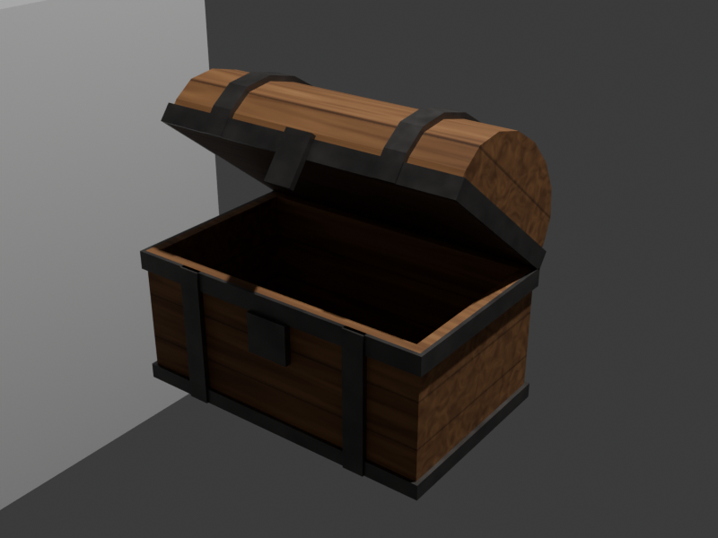

# Example: treasure chest (made by the blender agent)

The **blender** agent made this during a test run in a real Blender 5.2.5. It's a ready-made asset for testing the Roblox half of the pipeline, even before Blender is set up.

| File | What it is |
|---|---|
| `TreasureChest.fbx` | Two meshes, `Chest_Base` (184 triangles) and `Chest_Lid` (268 triangles). In meters, with textures embedded. |
| `Chest_*_Color.png`, `_Roughness.png`, `_Metalness.png` | Baked 1024×1024 PBR maps for a `SurfaceAppearance`, one set per part |
| `preview.png` | Cycles render with the lid opened 38° |

**Lid hinge:**
- The lid's pivot is on its bottom back edge, centred left to right. That's 0.307 m toward the back and 0.104 m below the centre of the lid's bounding box.
- In Blender, the lid opens about 100° backwards.

## Try it in Roblox Studio

1. Use **Import 3D** to import `TreasureChest.fbx`, with the scale unit set to **Meter**.
2. In Claude Code, type `/test-pipeline`. The roblox agent then does the rest:
   - sets the chest up
   - fixes the lid's hinge pivot
   - adds a **ProximityPrompt** that opens and closes the lid
   - playtests it

You can delete this folder when you no longer need it.
