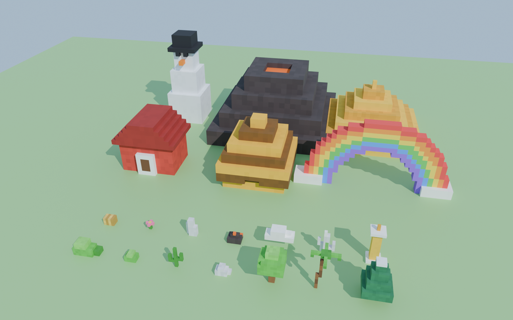

# Egg Run (working title)

A Roblox game. Every player has a base. A long canyon runs from the hub: run until your stamina runs out, and you hatch the egg of the furthest zone you reached. Each egg rolls a rarity (Common to Mythic) and hatches a cute animal. Animals auto-battle NPC waves in the **Battle Box** for coins, and coins buy speed and stamina, so each run goes further and reaches better eggs. You train your animals at your base.

**Status:** the **map** is ready to build in Studio. The gameplay systems (runs, eggs, animals, arena, UI) are next.

## First look in Studio

On your Mac, in the Claude Code session in `~/crypto`:

1. Run `git pull` to get these files.
2. Open your Roblox place in Studio, with the MCP server on.
3. Type **`/build-map`**. The roblox agent:
   - creates the scripts
   - builds the map
   - sets a fast walk speed for the test
   - takes screenshots and playtests a run down the canyon

**Optional, for the full look** (the map works without these, built from blocks):
- **Voxel kit:** in Studio, use **Import 3D** with `games/egg-run/assets/EggRunKit.glb` and Scale Unit **Studs**. Then move the imported model into **ReplicatedStorage** and name it **EggRunKit**.
- **Voxel Stud Egg Pack:** open `Voxel_Stud_Egg_Pack.rbxl` in Studio, copy `Workspace.EggPack`, and paste it into your game's **ReplicatedStorage**.
- After adding either one, rebuild the map by typing `/build-map` again, or run `require(game.ServerScriptService.EggRun.MapBuilder).Build()` in the command bar.

## The map ("Hatch Plaza" + the canyon)

| Area | What's there |
|---|---|
| **Hub** | Grass plaza with a stud-grid overlay, a cream aisle lined with voxel lamp posts, and the spawn facing the canyon |
| **Bases** | 6 coloured plots (3 each side of the aisle): a low voxel wall, an owner sign, a glowing **training pad**, 3 podiums for your team, trees and flowers |
| **Battle Box** | Behind the plaza: checkered floor, glass walls, blue and red team pads, a viewing deck with a ramp, and lights |
| **Canyon** | 140 studs wide with 80-stud checkerboard walls, a coloured cap on top, a checkered floor and voxel props along the walls (the centre stays clear) |
| **Zones** | 9 zones, one per egg of the Voxel Stud Egg Pack: Meadow (giant tree), Farm (barn), Hive (beehive), Beach (rainbow arch over the run), Snow (snowman), Volcano (volcano and lava pools), Storm (storm cloud), Crystal (giant crystal), Golden (pyramid). Each zone has a banner, a floating egg showing its best rarity, and its own floor, walls and props. |
| **Start / End** | A "RUN FOR EGGS!" banner with a giant Golden Egg on top (the landmark you see from the spawn); a golden end wall with a big egg |

Everything comes from `src/ReplicatedStorage/EggRun/Config.luau` (zones, colours, props, sizes) and `Layout.luau` (positions). Change a number and rebuild.

## Files

| Path | What |
|---|---|
| `src/ReplicatedStorage/EggRun/` | `Config`, `Layout`, `Props` (shared) |
| `src/ServerScriptService/EggRun/MapBuilder.luau` | Builds `Workspace.EggRunMap` |
| `src/ReplicatedStorage/LihFolk/`, `src/ServerScriptService/LihFolk/` | LihFolk modules used by the gameplay systems (credits in `CREDITS.md`) |
| `assets/EggRunKit.glb` | 20 voxel props and landmarks, made in Blender (vertex colours, 1 unit = 1 stud) |
| `tools/voxel_kit.py` | Rebuilds the kit: `blender -b --factory-startup --python tools/voxel_kit.py -- <out> <LihFolk roblox-blender-modeling/scripts>` |

## Balance (simulated)

A typical player reaches zone 2 in about 2 minutes, zone 4 in 10 to 20 minutes, and the Golden zone after about 4.5 to 5.5 hours. Arena level 30 takes about 4 to 6 hours.
